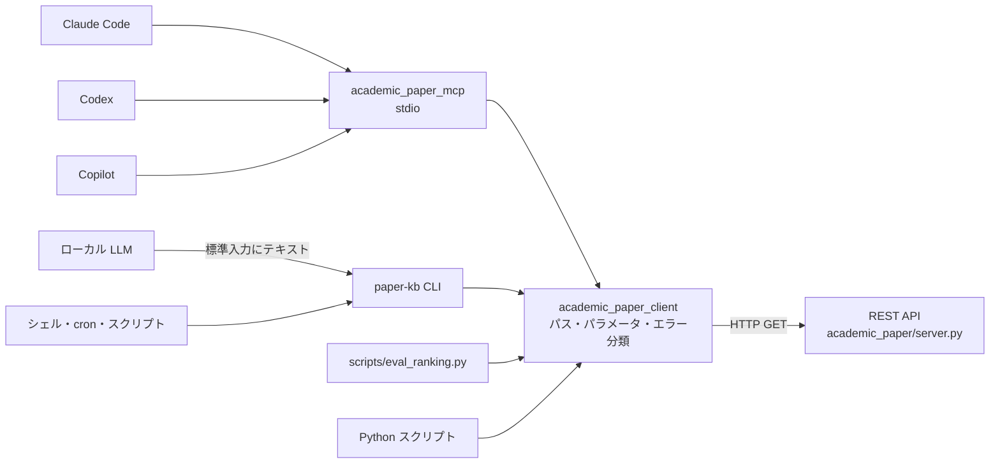

# クライアント接続と精度の日次測定(設計ドラフト)

状態: **Draft(2026-11-29)**。実装は MCP サーバー(PR #906)のみ。以降は未実装の提案。
「確認済み」は手元のコマンド出力・コードで確かめたこと、「未確認」は書式や挙動を確かめていないこと。

## 目的と非目標

目的:
- Claude・Codex・Copilot・ローカル LLM・スクリプトのどれからでも、同じ知識ベース(検索・要約・メタデータ)を**読める**ようにする
- 関連度スコアと検索の精度を**毎日測り**、改修の良し悪しと劣化を数字で見る

非目標:
- 取り込み・要約生成・スコア計算を MCP / CLI から呼べるようにすること(書き込み系は REST を直接使う)
- claude.ai(Web)など、公開 HTTPS の窓口が要る接続
- 精度の目標値を先に決めること(測ってから決める)

## 現状(実物で確認)

| 項目 | 状態 | 根拠 |
|---|---|---|
| REST API | 稼働。`X-API-Key` 認証 | `academic_paper/auth.py` |
| 読み取り専用キー | **無い**。`API_KEY`/`API_KEYS` は全スコープ、スコープ限定は `INGEST_API_KEY` のみ | `auth.py` の `resolve_scopes` |
| MCP サーバー(stdio、読み取り系 5 ツール) | PR #906(draft) | `academic_paper_mcp/` |
| 定時実行 | このリポには無く、非公開の ops リポ側 | `CLAUDE.md` 「CI」の記述 |
| 評価用のラベル・クエリ集 | 無い | — |

## 全体構成



方針: **口は二つ(MCP と CLI)、中身は一つ(core)**。口ごとに URL 組み立てやエラー処理を書き直すと挙動がずれるので、I/O を持たない部分だけ共有する。

### 層1: `academic_paper_client`(新規、小さく)

- 共有するもの(I/O 無し): エンドポイントごとのパス・クエリの組み立て(未指定の絞り込みは送らない)、HTTP ステータス→種別(`auth` / `forbidden` / `not_found` / `bad_request` / `unreachable` / `timeout` / `server`)の分類。
- 共有しないもの: 実際の送信。MCP は `httpx.AsyncClient`、CLI とスクリプトは `httpx.Client` と、薄い層を二つ持つ。
- エラー文は #906 の方針を引き継ぐ: キー・応答本文・例外文を含めない。
- `server.py` の `make_client` / `_get` はここに移す(移すだけで挙動は変えない。#906 のテストがそのまま回帰テストになる)。

### 層2a: MCP(済み・#906)

ツールは `search_papers` / `get_paper` / `get_summary` / `list_papers` / `library_stats`。すべて読み取り専用。

### 層2b: CLI `paper-kb`(新規)

```text
paper-kb search "クエリ" [--mode nugget|hybrid|vector|keyword] [--limit 5] [--paper-id N]
                         [--format json|text] [--max-chars N]
paper-kb paper ID
paper-kb summary ID
paper-kb list [--limit 20] [--offset 0] [--author A] [--category C] [--sort ingested_at|score]
paper-kb stats
```

- 接続先とキーは環境変数 `PAPER_API_URL` / `PAPER_API_KEY` のみ。キーをコマンドライン引数で受けない(プロセス一覧に出るため)。
- 標準出力は**結果だけ**、診断は標準エラー。既定は `--format json`。
- `--format text` は LLM に読ませる用: `[paper_id p.ページ] 本文` を 1 行 1 件で出し、`--max-chars` を超える分は件数単位で切る(文の途中で切らない)。
- 終了コード: 0 成功 / 2 引数不正 / 3 認証・権限 / 4 見つからない / 5 到達不能・タイムアウト / 1 その他。スクリプトが分岐できるようにする。
- 配布: `pyproject.toml` の `[project.scripts]` に `paper-kb` を足す。依存は MCP 無しで動く(`mcp` extra は不要)。

## クライアント別の接続

| クライアント | 経路 | 登録 | 状態 |
|---|---|---|---|
| Claude Code | MCP(stdio) | `claude mcp add academic-papers -e PAPER_API_URL=… -e PAPER_API_KEY=… -- <python> -m academic_paper_mcp` | 書式はヘルプで確認済み。実接続は未実施 |
| Codex | MCP(stdio) | `codex mcp add academic-papers --env PAPER_API_URL=… --env PAPER_API_KEY=… -- <python> -m academic_paper_mcp`(または `~/.codex/config.toml` の `[mcp_servers.…]`) | 書式はヘルプで確認済み(stdio と `--url` の両方に対応)。実接続は未実施 |
| Copilot | MCP(stdio) | **未確認**。この環境の `copilot` は VS Code 同梱の入口で、CLI 本体は未インストール(`copilot --version` が「見つからない」と返す)。VS Code 側の MCP 設定ファイルの書式は未確認 | `NEEDS_CONFIRMATION` |
| ローカル LLM | **CLI のパイプ**(MCP は使わない) | `paper-kb search "…" --format text --max-chars 3000 \| llm "この抜粋から…を答えて"` | 設計のみ |
| スクリプト | CLI または Python import | `paper-kb … --format json \| jq …` / `from academic_paper_client import …` | 設計のみ |

ローカル LLM を MCP にしない理由:
1. 運用方針(非公開)が入口を CLI に限っている。
2. 小型の台は文脈長が短く(入力予算は数千字)、検索結果を**呼び出し側で絞って渡す**ほうが合う。`nugget` モードと `--max-chars` はそのため。
3. 論文本文は外部テキストで、小型モデルは文中の指示に従いやすいという実測がある。パイプなら LLM に書き込み・実行のツールを渡さずに済み、「外部テキストを読むジョブに書き込みを持たせない」を構造で満たせる。
4. 論文 RAG は方針上「測っていない用途」なので、採用欄に入れる前に、下の日次測定で数字を取る。

## 調整の分け方(土台 / ターゲット)

土台とターゲットを別々に調整できるよう、**変える理由が違うものを別の置き場**にする。

| | 土台(全クライアント共通) | ターゲット(クライアント・用途ごと) |
|---|---|---|
| 中身 | エンドポイントとパラメータ、エラー分類、読み取り専用、キーを出さない、結果の JSON の形。スコアの土台成分(鮮度・カテゴリ一致=現行式)。検索の土台(hybrid の RRF、nugget 抽出) | 検索の既定値(`mode` / `limit` / `snippet_length` / `nuggets_per_chunk` / `max_chars`)、出力形式、MCP のツール説明文、使うキーの環境変数名。スコアでは関心トピック(語と重み)と、土台との合成の重み |
| 置き場 | コード(`academic_paper_client`、`academic_paper/scorer.py`)。テストで守る | プロファイル(下)と、非公開の評価セット・トピック定義(データ) |
| 変えるとき | 土台の PR。全クライアントに効くので、評価の数字で良し悪しを見る | 設定・データの更新だけ。コード変更なし |

**プロファイル**: `PAPER_PROFILE=<名前>`(CLI は `--profile`)で選ぶ、数行の既定値の束。同梱は `claude` / `codex` / `copilot` / `local-llm` / `script` の 5 つで、`local-llm` は短い入力予算に収まるよう `mode=nugget`・`limit=3`・`max_chars=3000` のように絞る。利用者の上書きは `~/.config/paper-kb/profiles.toml`(リポジトリの外)。優先順位は 引数 > 環境変数 > プロファイル > 土台の既定。

**スコア**: 土台の `score`(鮮度+カテゴリ、現行式のまま)と、ターゲットの `topic_score`(関心トピックとの類似度)を**別の値として持つ**。最終順位は `base_weight * score + topic_weight * topic_score` で、重みはターゲット側の設定。こうすると、土台の式を直す PR と、トピック・重みを変える更新が干渉しない。

**測定も二つに分ける**(日次ジョブの指標):
- 土台の指標: 検索の recall@k / MRR と運用の健全性。どのターゲットでも同じ値になる
- ターゲットの指標: トピックごとの precision@10 / nDCG@10。トピックやプロファイルを変えたときの差だけを見る

## 認証

現状、読み取り専用のキーを作れない。MCP・CLI・評価はどれも GET しか呼ばないが、渡すキーは全権になる。

提案: `READ_API_KEY`(カンマ区切りで複数可)を足し、`resolve_scopes` で `{READ}` だけを返す。
- クライアントごとにキーを分ける(Claude 用・Codex 用・CLI 用・評価用)。漏れたものだけ失効できる。
- ingest 用の既存キーとはスコープが違うため、収集 cron が読み取りキーで ingest できない(逆も同様)ことをテストで固定する。
- キーは環境変数で渡し、設定ファイルやリポジトリに実値を置かない。

これが入るまでは、README に「渡すキーは全権になる」と明記し、信頼できるマシンの Claude Code / Codex だけに限る。

## 精度の日次測定

### 何を測るか

1. **スコアの内容精度**: 関心トピックに沿って人が付けた〇×に対し、スコア順の上位 k 件の適合率(precision@10)と、〇が上位に来る度合い(nDCG@10)。現行の式(鮮度+カテゴリ)と新方式(関心トピックとの embedding 類似度など)を同じラベルで比べる。
2. **検索の精度**: 評価用クエリごとに正解の論文を決め、`hybrid` / `nugget` の recall@k と MRR。
3. **運用の健全性**(精度ではないが同じジョブで測れる): `/stats` の件数、スコア未計算の論文数、スコアの最終計算日。現状のように値が古いまま気づかない事態を検知する。

### 評価セットの置き場

- ラベル(関心トピックの〇×)と評価用クエリは個人の関心を表すので、**公開リポには置かない**。置き場は ops リポ(非公開)。このリポには、スキーマと合成データの例だけを置く(`eval/schema.md`、`eval/example.jsonl`)。
- ラベルは dev(調整用)と test(最終確認用)に分け、test は改修中に見ない。同じ 30〜40 件で調整して同じ 30〜40 件で評価すると、改善の見かけが出てしまう。
- ラベル付けする論文は `paper_id` で固定し、日々増えるコーパス全体ではなく**固定した部分集合**で測る。そうしないと、新着の取り込みで順位が動くだけで指標が変わる。

### 鮮度の扱い

現行スコアの鮮度は半減期 30 日で毎日下がるので、スコア全体を毎日測ると「時間が経った」だけで指標が動く。分けて測る:
- 内容精度は、鮮度を除いたスコア(カテゴリまたは新方式の成分だけ)で測る → 日々の差は改修か環境の変化を表す
- 鮮度込みの最終順位は別指標にして、「新しい論文が上に来ているか」だけを見る

### 日次ジョブ

- 実装: `scripts/eval_ranking.py`(このリポ)。`paper-kb` と同じ core を使い、評価セットのパスと API の接続先を引数・環境変数で受ける。LLM は呼ばない(API の検索と embedding のみ)。
- 実行: ops リポの定時ワークフローが、読み取り専用キーでこのスクリプトを呼ぶ。結果は 1 日 1 行の JSON(日付・コミット・指標・件数)として追記する。
- 通知: 直近 7 日の平均より指標が一定以上落ちたとき、既存の通知(`DISCORD_WEBHOOK_URL`)に 1 行。閾値は、数日分を測ってから決める。
- 失敗の扱い: API に届かない日は「測れなかった」と記録し、指標を 0 にしない。

## 実装の順序(1 PR = 1 目的)

| # | 内容 | 前提 |
|---|---|---|
| P0 | MCP サーバー(#906)。README の「読み取り専用キー」の記述を訂正 | — |
| P1 | `academic_paper_client` を抽出し、MCP を載せ替える(挙動は不変) | P0 |
| P2 | `paper-kb` CLI(`--format text`・終了コード)とプロファイル | P1 |
| P3 | `READ_API_KEY`(読み取り専用キー)とスコープのテスト | — |
| P4 | 評価ハーネス `eval_ranking.py` と評価セットのスキーマ(ラベルは非公開) | P1、ラベル |
| P5 | スコア改修(関心トピックとの類似度)を、P4 の数字で現行式と比較して採否を決める | P4 |
| P6 | ops リポの日次ジョブ。数日分の実測から通知の閾値を決める | P4 |
| P7 | クライアント別の接続手順(`docs/manual.md`)。Copilot の書式を確認してから | P2、P3 |

## 未決・要確認

- **Copilot の MCP 設定の置き場と書式**(CLI 本体の導入が先)。
- **関心トピックの定義と、〇×を付ける論文 30〜40 件**(人が付ける。付け方を決めるのが P4・P5 の前提)。
- 評価ジョブを走らせる ops リポ側の実行環境から、API に届くか(未確認)。
- 新方式のスコア(embedding 類似度)を保存する場所: 既存の `score` を置き換えるか、`topic_score` を別に持つか。
- `paper-kb` を `scripts/` に置くか、パッケージ配下に置くか(`tests/test_scripts_deps.py` の制約との兼ね合い)。
