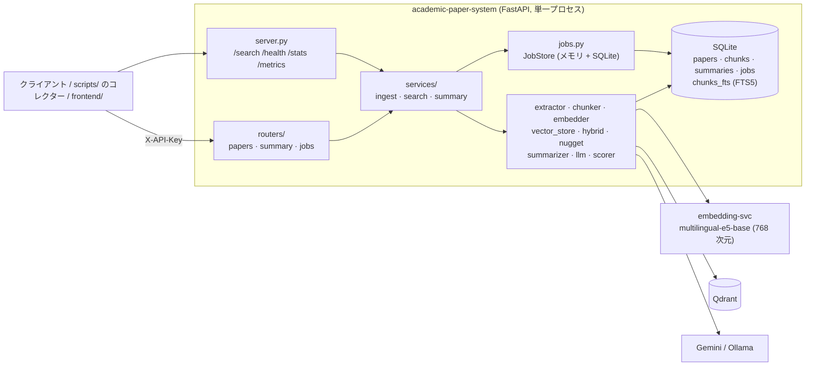
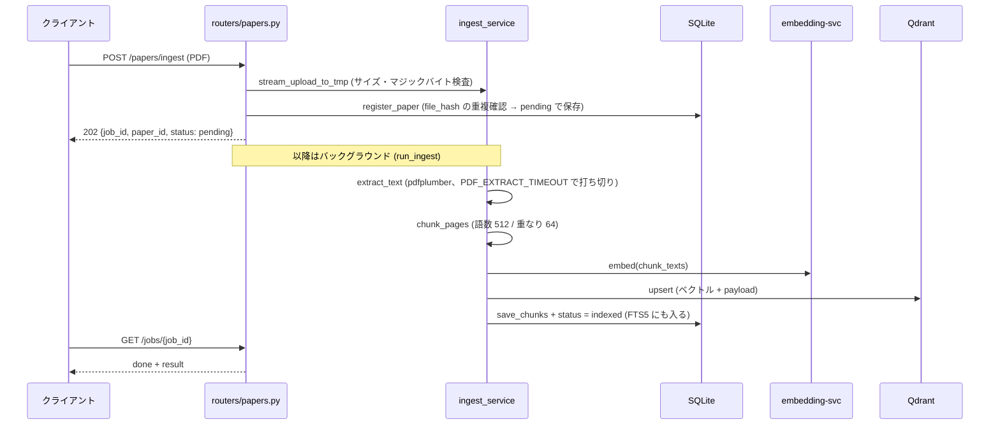

# 設計書

対象: `main`(1174fe1 時点)。外から見た振る舞いは [API 仕様](spec/api.md)、設定は[設定仕様](spec/configuration.md)にあります。この文書は内側の構造を説明します。

## 全体像

PDF を取り込み、全文検索とベクトル検索の両方で引け、LLM で構造化要約を作る RAG サービスです。FastAPI の単一プロセスで動き、外部には embedding-svc・Qdrant・LLM(Gemini または Ollama)があります。

## 取り込みの流れ

`POST /papers/ingest` は、ファイルを一時ファイルへストリーム保存しながら、サイズ上限と `%PDF-` の先頭バイトを検査します(`services/ingest_service.py`)。その後は次の順です。

失敗時の後始末(`run_ingest`):

- ジョブを `failed` にし、論文の `status` も `failed` にします。
- 途中まで書いた Qdrant のベクトルを削除します(upsert はバッチ送信のため、途中失敗で前半が残るのを防ぐ)。
- 一時ファイルは、成功・失敗・キャンセルのいずれでも削除します。
- DB 書き込みはスレッドで実行し、キャンセルされても書き込みの完了を待ってから補償処理に進みます。`indexed` の書き込みより前に補償が走らないようにするためです。
- 同じ内容の PDF は `file_hash` で重複判定します。`failed` の論文は消してから取り込み直せます。`pending` の論文は消さずに 409 にします(実行中のジョブの Qdrant 補償が新しい論文のベクトルまで消さないようにするため)。
- サーバー起動時に `pending` のまま残った論文は `failed` にし、Qdrant のベクトルを削除します。

## 検索の流れ

`services/search_service.py` が 4 モードを分けます(FastAPI には依存しない)。

| モード | 経路 |
| --- | --- |
| `keyword` | SQLite の FTS5(`chunks_fts`、`unicode61`)を `bm25()` で並べる。クエリの各語は引用符で囲み、演算子として解釈させない |
| `vector` | クエリを embedding-svc でベクトル化し、Qdrant で近いチャンクを引く |
| `hybrid` | 上の 2 つを RRF(`1 / (60 + 順位)` の和)で統合する(`hybrid.py`) |
| `nugget` | `hybrid` の後、各チャンクからクエリに近い文だけを抜き出す(`nugget.py`)。文の採点は BM25 と embedding の重み付き和 |

## 要約の流れ

`summarizer.py`(`RAGSummarizer`)は、論文の要約に使うチャンクを、Qdrant の類似検索で上位 `top_k`(既定 5)件取ります。Qdrant や embedding が使えないときは、SQLite から `chunk_index` の先頭 `top_k` 件を読む代替経路(`chunk_loader`)に切り替えます。そのチャンクをプロンプトに入れ、LLM に JSON を出させます。出力は `models.PaperSummary` で検証します(LLM がネストした値を返しても JSON 文字列として保持する)。`summarize()` 全体と、その中の `llm.generate()` にはそれぞれ上限時間があります([設定仕様](spec/configuration.md))。結果は `summaries` テーブルに upsert し、`GET .../summary` はそれだけを読みます。

LLM クライアント(`llm.py`)は `LLM_PROVIDER` で決まります。`none` のとき `summarizer` は作られず、要約系の API は 503 です。

## ディレクトリの責務

| パス | 責務 |
| --- | --- |
| `academic_paper/server.py` | アプリの組み立て(lifespan、ミドルウェア、セキュリティヘッダ、`/health` `/stats` `/search` `/metrics`、`/ui` の mount) |
| `academic_paper/routers/` | `papers`・`summary`・`jobs` の HTTP ルート。入力の受け取りと、例外から HTTP への変換だけを担う |
| `academic_paper/services/` | 取り込み・検索・要約のロジック。`ingest_service` と `search_service` は `app.state` に依存せず、依存を引数で受ける(FastAPI を起動せずにテストできる) |
| `academic_paper/auth.py` | `X-API-Key` の検証とスコープ(`ingest` / `read` / `admin`) |
| `academic_paper/errors.py`, `http_status.py` | 例外の分類と HTTP ステータスへの対応(HTTP に依存しない分類と、`HTTPException` への変換を分ける) |
| `academic_paper/db.py` | SQLite の初期化・CRUD・FTS5 検索 |
| `academic_paper/jobs.py` | バックグラウンドジョブの状態管理 |
| `academic_paper/extractor.py`, `chunker.py` | PDF のテキスト抽出と、ページを意識したチャンク分割 |
| `academic_paper/embedder.py`, `vector_store.py` | embedding-svc と Qdrant のクライアント |
| `academic_paper/hybrid.py`, `nugget.py`, `scorer.py` | RRF 統合、文の抽出、関連度スコア(鮮度と優先カテゴリ) |
| `academic_paper/summarizer.py`, `llm.py`, `models.py` | RAG 要約、Gemini / Ollama のクライアント、要約のスキーマ |
| `academic_paper/validators.py` | メタデータ(`published_date`・`authors` など)の検証と、制御文字の除去 |
| `academic_paper/config.py` | `Settings`(環境変数)と起動時の検証 |
| `academic_paper/logging_config.py`, `telemetry.py` | JSON ログ、OpenTelemetry |
| `scripts/` | 論文収集(arXiv・PubMed・OpenAlex・Semantic Scholar)、ポートフォリオ生成、ロック再生成。API を HTTP で呼ぶだけで、サーバーのコードには依存しない |
| `frontend/` | 静的 UI(`/ui` に mount) |
| `docs/` | 設計・仕様・ADR・マニュアル(ほかにポートフォリオの静的ページ `index.html` / `papers.json`) |

## データモデル(SQLite)

`db.init_db()` が起動時に作ります(`CREATE TABLE IF NOT EXISTS` と、列の追加マイグレーション)。

| テーブル | 主な内容 |
| --- | --- |
| `papers` | `file_hash`(UNIQUE)、`file_name`、メタデータ(`title`・`authors`・`categories`・`published_date`・`source`・`arxiv_id`)、`score`、`status`(`pending` / `indexed` / `failed`) |
| `chunks` | `paper_id`、`chunk_index`、`page_start`・`page_end`、`text`、`qdrant_id`(UNIQUE) |
| `summaries` | `paper_id`(UNIQUE)、`model`、`objective`・`method`・`results`・`limitations`・`keywords`、`raw_json`、`created_at` |
| `jobs` | `id`、`status`、`kind`、`total`・`processed`・`failed`、`errors`、`started_at`・`finished_at`、`result` |
| `chunks_fts` | FTS5 の仮想テーブル。`chunks.text` を外部コンテンツとして索引する(`content='chunks'`) |

Qdrant 側は、チャンク 1 件が 1 点です。点の ID は `file_hash` とチャンク番号から決まり(`make_qdrant_id`)、payload に `paper_id`・`chunk_index`・`text`・`file_name` を持ちます。

## 主要な制約

- **単一プロセス**: ジョブの読み取りの正本がプロセス内のメモリです。`--workers>1` やレプリカ増設には未対応です([ADR](adr/20261127-single-process-job-store.md))。
- **認証は fail-closed**: 認証キーが無いと起動しません([ADR](adr/20261127-fail-closed-auth.md))。
- **ベクトルの次元は設定で固定**: Qdrant のコレクションは `EMBEDDING_DIM`(既定 768、コサイン距離)で作られます。既存のコレクションの次元が違うと `ValueError` になるため、embedding モデルを変えるときはコレクションを作り直す必要があります。
- **索引の二重化**: SQLite の FTS5 と Qdrant を別々に更新するため、片方だけ成功した状態が起きうる。取り込みの補償処理と起動時の後始末はこのためにあります。
- **タイムアウトの下限**: 要約系のタイムアウトには、上位の値が下位の合計を下回らないという制約があります([設定仕様](spec/configuration.md))。

検索方式の選定は [ADR(RRF)](adr/20261011-01-recorded-decision.md) を参照してください。
